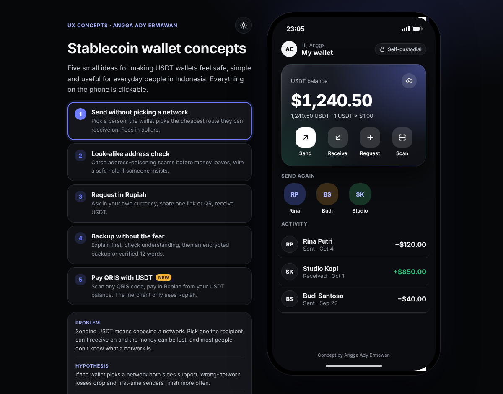

# Stablecoin wallet concepts

Four small, clickable UX concepts for making a USDT wallet feel safe and simple for everyday people.

**Live demo:** https://aaegraphic-coder.github.io/wallet-concepts/

## The ideas

1. **Send without picking a network.** You choose a person, not a chain. The wallet picks the cheapest safe route, shows every fee in dollars, and ends with a clear "Arrived" moment.
2. **Look-alike address check.** Address-poisoning scams copy the first and last characters of someone you pay. The wallet compares a pasted address with saved contacts and highlights the difference.
3. **Request in Rupiah.** Ask for money in your own currency, share one link, and receive the matching amount of USDT.
4. **Backup without the fear.** Explain why backup matters, check understanding with one question, then offer an encrypted backup before showing 12 words.

## About

Designed by Angga Ady Ermawan, Senior Product Designer. Built as a single HTML file with AI-assisted prototyping tools.

These are personal concepts made for a job application. Not affiliated with or endorsed by any wallet provider. Fees, exchange rates and names are examples only.
